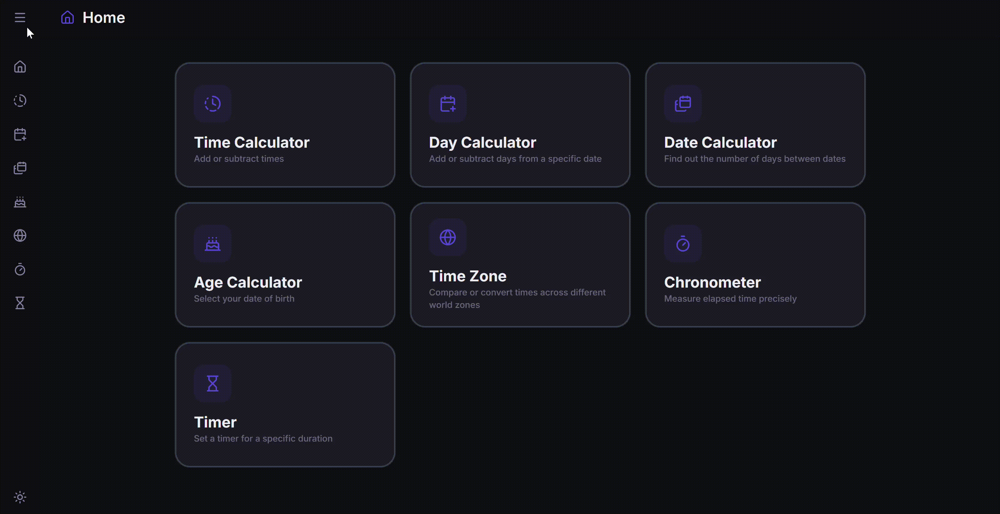

# TimeTool ⏱️

A web-based time utility application built with React and Vite. TimeTool provides a comprehensive suite of tools for calculating, converting, and manipulating time, including date calculators, time zone converters, and productivity timers.

> [Demo site](https://time-tools-git-main-chrstnhus-projects.vercel.app/)



## 📋 Table of Contents

- [About](#-about)
- [Features](#-features)
- [Tech Stack](#-tech-stack)
- [Project Structure](#-project-structure)
- [Installation](#-installation)
- [Usage](#-usage)
- [Architecture](#-architecture)

## 🎯 About

TimeTool is a utility designed to simplify daily time management (calculate time, convert date or time zone, chronometer).
TimeTool offers a modern, responsive, and optimized interface.

The project is built with a modular architecture to facilitate the addition of new time-based tools.

## ✨ Features

- **Time Calculator:**
  - _Operation Mode:_ Add or subtract on time to calculate totals or specific durations.

  - _Interval Mode:_ Calculate the exact elapsed time span between two specific points in time, including multi-day tracking.

- **Day Calculator:** Add or subtract days from a specific date
- **Date Calculator:** Calculate the duration or difference between two specific dates.
- **Age Calculator:** Calculate exact age in years, months, and days based on a birth date.
- **Time Zone:** Compare and convert time across different world zones.
- **Chronometer:** Measure elapsed time precisely with lap tracking functionality.
- **Timer:** Set and track custom countdowns for your activities.
- **UX/UI:** Responsive design, dark/light mode support, and reusable UI components.

## 🛠 Tech Stack

Frontend: HTML, CSS, JavaScript, React, Vite

Styling: Tailwind CSS

State Management: React Hooks

## 📁 Project Structure

Plaintext
timetool/
├── src/
│ ├── components/ # Reusable UI components & business logic
│ ├── pages/ # Main application views
│ ├── utils/ # Calculation functions (date, time, conversion)
│ ├── hooks/ # Custom React hooks
│ ├── constants/ # Static data (time zones, menu items)
│ ├── lib/ # Generic utility functions
│ └── assets/ # Images and static resources
├── index.css # Global styles
└── main.jsx # React entry point

## 🚀 Installation

Prerequisites
Node.js (version 18+ recommended)

```bash
npm or yarn
```

Steps
Clone the repository:

```bash
git clone [YOUR_REPO_URL]
cd timetool
```

Install dependencies:

```bash
npm install
```

Start the project in development mode:

```bash
npm run dev
```

## 🎮 Usage

The application is accessible via your browser at the default port (usually http://localhost:5173).

## 🏗 Architecture

The project follows a clean separation of concerns:

Pages: Each file in src/pages/ represents a specific route.

Components: Organized into sub-folders (calculator, time, layout, ui) for easy maintenance.

Logic (Utils): All mathematical logic (date calculations, time zone conversions) is extracted into src/utils/, allowing for easy testing independent of the UI components.
